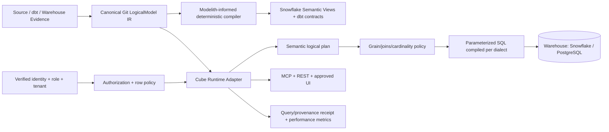

# Drizzle Cube donor → ADE OS Semantic Query Runtime (REA-SG-17)

**Snapshot:** 2026-10-18 ET  
**Reddit source:** https://www.reddit.com/r/SideProject/comments/1x925vo/lets_discover_each_others_github_projects/  
**Upstream:** https://github.com/cliftonc/drizzle-cube/tree/0824c7471212d03f046f369703fc928c126f43bf  
**Commit SHA:** `0824c7471212d03f046f369703fc928c126f43bf`  
**License:** MIT; third-party dependency and data-provider license audit still required.  
**Roadmap issue:** https://github.com/rrahul0904/agent-work-os/issues/285  
**Converges with:** https://github.com/rrahul0904/agent-work-os/issues/227 (Modelith), #85 (Backbone), #89 (Data Workbench).

## Canonical decision

**DONOR → existing ADE OS product**, not a new repo or independent semantic platform. Agent Work OS stores evidence/governance/execution/Shipping OS truth. ADE OS owns authoritative Git-native logical model IR, Snowflake Semantic Views, dbt and governed SQL operations.

Modelith fills the **model authoring/reverse-engineering/multi-target compilation** boundary. Drizzle Cube fills an adjacent **embedded analytical query runtime** boundary: API, typed measures/dimensions/joins, generated SQL and React/MCP transports. These are not duplicate products.

## Evidence-based source components

From upstream README and `CONTEXT-MAP.md`, plus the repository root:

- `src/server`: semantic layer (cube, measure, dimension, logical/physical plan, execution).
- `src/adapters`: HTTP handler, MCP transport, API, security context and locale propagation.
- `src/client`: analytics dashboards, query and chart visualization.
- `docs/adr` and `src/<area>/docs/adr`: architectural decisions.
- `perf`, `tests`, `playwright.config.ts`, `vitest.config.*`: available source benchmark/testing surfaces.
- Upstream `SECURITY.md` lists supported release train 0.4.x at inspected snapshot. No assertion of owned compatibility is made.

The public README explicitly places identity, authorization and tenant scoping responsibility with the **host application**. Its `x-organisation-id` example is suitable only for demos; it is **not** authenticated tenancy.

## Target architecture



## Contracts to design

```ts
type VerifiedPrincipal = { subject: string; tenantId: string; roles: string[]; issuer: string; verifiedAt: string };
type GovernedMetric = { id: string; measure: string; dimensions: string[]; grain: string[]; lineageIds: string[]; semanticVersion: string };
type SemanticQuerySpec = { modelRevision: string; cubeId: string; metrics: string[]; dimensions: string[]; filters: unknown[]; limit: number; principal: VerifiedPrincipal };
type GovernedQueryReceipt = { exactModelCommit: string; compilerVersion: string; normalizedSpecHash: string; boundSqlHash: string; principalPolicyHash: string; rowCount: number; queryTimeMs: number; assertionIds: string[] };
```

## Required observable flows

1. Ingest a verified existing Drizzle schema or source warehouse metadata into the ADE logical IR without authoritatively mutating the model during extraction.
2. Project governed measures/dimensions/joins into a runtime cube definition with stable names and lineage.
3. Authenticate upstream (OIDC/session or short-lived service identity); **derive** tenantId server-side. Never accept an unauthenticated request header as identity.
4. Reject inaccessible cubes, dimensions, measures and filters *before SQL generation*; apply RLS and tenant predicates in backend.
5. Determine safe fact grain, many-to-many relationships and aggregation semantics; emit parameterized SQL with explicit limits/timeouts.
6. Run a read-only query in an approved fixture database; return totals/cell metadata and provenance version.
7. Expose the same metric through REST, dashboard and MCP. Compare all outputs against a canonical fixture and fail closed on mismatch.
8. On schema/model drift, produce an explicit diff/impact report and require approval before compilation/release.

## Comparison benchmark

- **Drizzle Cube**: embedded Drizzle-native cubes + transports.
- **Cube**: query orchestration, semantic model and caching baseline.
- **dbt Semantic Layer**: versioned metric definitions and semantic model.
- **Snowflake Semantic Views**: platform-native governed business semantics.
- **ADE OS/Modelith**: **authoritative owned logical IR and deterministic round-trip compiler**; owns all generated targets.

Benchmarks must include cold/warm P50/P95, tenant boundaries, join correctness, 10M+ synthetic-row scan cost, schema drift, compatibility, and lineaged metric equivalence. Numbers are NOT established by this intake.

## Threat and negative fixtures

- Forged `x-organisation-id` header should never change query tenant.
- Filter injection, unauthorized metrics, arbitrary SQL/raw query, nested metrics, disallowed joins, adversarial cardinality.
- No elevation through MCP tools or model-generated instructions; read-only provider service identity.
- Conflicting metric definitions across dbt/Snowflake/Drizzle projections fail the compiler rather than silently choose one.
- Partial failures, timeout, stale cache, incompatible dialect, dropped columns, schema rename and replay stability.
- Model artifact and source evidence license/provenance gates.

## Release phases / status

- [x] Resolve source and pin exact SHA/licensing at repository level.
- [x] Identify code-area boundaries from the repo's own context map and README.
- [x] Route to owned ADE OS and dedupe Modelith.
- [ ] Read pinned architecture/security ADRs and actual compiler/adapter code.
- [ ] Run a clean dependency/security audit and upstream local test baseline.
- [ ] Write versioned full `SemanticQuerySpec`/compiler adapters into ADE OS.
- [ ] Add synthetic Snowflake/Postgres fixture model and deterministic query test corpus.
- [ ] Record complete multi-tenant tests, plan correctness, provider-source credential enforcement.
- [ ] Show exact-head CI receipt, independent review, approved deployment and UAT.

**No code/runtime parity, integration, CI, UAT or deployment has been verified as of this casebook.**
